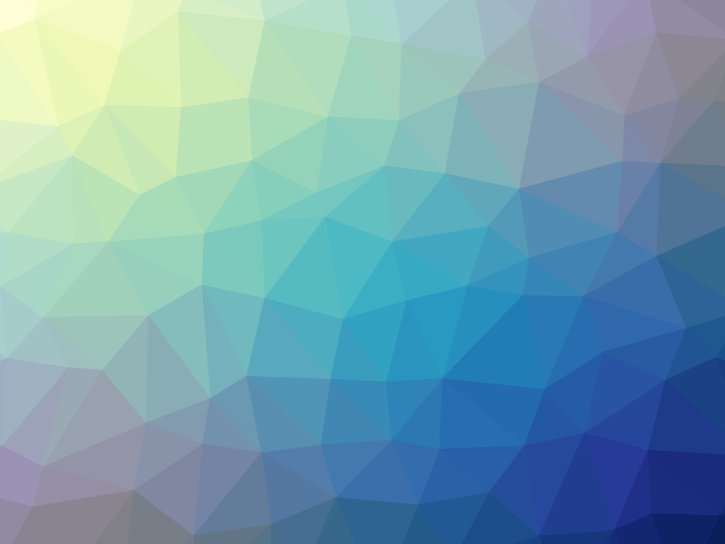

# trianglify-java

Porte em Java da biblioteca [Trianglify](https://github.com/qrohlf/trianglify) (v4.1.1, de Quinn Rohlf),
que gera malhas triangulares coloridas no estilo *low poly*.

Roda pela linha de comando e lê todos os parâmetros de `trianglify.properties`, na raiz do projeto.
O build é feito com Gradle, mas o projeto **não tem nenhuma dependência externa**: a triangulação de
Delaunay, as conversões de cor e a rasterização usam só a biblioteca padrão do JDK.



## Requisitos

Um JDK 17 ou mais novo. O Gradle vem junto pelo wrapper — não precisa instalar nada além do JDK.

## Uso

```bash
./gradlew run
```

Isso compila, lê `trianglify.properties` e grava a imagem no caminho indicado por `output.file`.

Qualquer parâmetro pode ser sobrescrito na linha de comando, sem editar o arquivo:

```bash
./gradlew run --args="--seed=praia --xColors=Spectral --output.file=praia.png"
```

Como o `--args="..."` é chato de digitar, existe o atalho `run.sh`, que passa os argumentos direto:

```bash
./run.sh --width=2560 --height=1440 --cellSize=40 --output.scale=2
```

Para ver todas as opções:

```bash
./run.sh --help
```

### Ver todas as paletas de cores

```bash
./gerar-paletas.sh
```

Gera uma imagem para cada uma das 27 paletas em `saida/paletas/`, todas com a mesma semente e as
mesmas dimensões — o que muda de uma para outra é só a cor, então dá para comparar lado a lado.
Junto vai um `index.html` que mostra todas em grade.

O script aceita as mesmas chaves do gerador, o que permite variar também a aparência:

```bash
./gerar-paletas.sh --seed=praia --width=800 --height=600
./gerar-paletas.sh --colorFunction=shadows --colorFunction.arg=0.9
./gerar-paletas.sh --format=svg --out=/tmp/paletas --sem-indice
```

A lista de paletas vem do próprio gerador (`--listar-paletas`), então o script não mantém uma cópia
que possa ficar desatualizada.

### Outras tarefas do Gradle

```bash
./gradlew build         # compila e empacota
./gradlew installDist   # gera o executável em build/install/trianglify/bin/trianglify
./gradlew tasks         # lista as tarefas disponíveis
```

O `build` também produz um jar executável:

```bash
java -jar build/libs/trianglify-java-1.0.0.jar --config=outro-perfil.properties
```

O arquivo de propriedades é procurado no diretório atual e, se não estiver lá, subindo a partir da
localização do jar — então as quatro formas acima encontram o `trianglify.properties` da raiz sem
configuração extra.

## Parâmetros

Todos ficam em [`trianglify.properties`](trianglify.properties), que tem a descrição de cada um.
Em resumo:

| Chave | Padrão | O que faz |
| --- | --- | --- |
| `width`, `height` | `800`, `600` | Dimensões da imagem em pixels |
| `cellSize` | `75` | Tamanho da célula da grade; menor = mais triângulos |
| `variance` | `0.75` | Jitter dos pontos, de `0` (grade regular) a `1` |
| `seed` | `zyn` | Semente; a mesma semente reproduz o mesmo padrão. Vazio = aleatória |
| `points` | — | Pontos explícitos (`x1,y1; x2,y2; ...`), no lugar da grade |
| `xColors` | `YlGnBu` | Gradiente do eixo X: paleta ColorBrewer, `random`, ou lista de hex |
| `yColors` | `match` | Gradiente do eixo Y; `match` reaproveita o do eixo X |
| `colorSpace` | `lab` | Espaço de interpolação: `lab` ou `rgb` |
| `colorFunction` | `interpolateLinear` | `interpolateLinear`, `sparkle` ou `shadows` |
| `colorFunction.arg` | `0.5` | Parâmetro da função de cor (veja o .properties) |
| `fill` | `true` | Preencher os triângulos |
| `strokeWidth` | `0` | Espessura do contorno; com `fill=false` vira wireframe |
| `output.file` | `saida/trianglify.png` | Caminho de saída |
| `output.format` | `both` | `png`, `svg` ou `both` |
| `output.scale` | `1` | Supersampling do PNG (2 = telas de alta densidade) |
| `svg.coordinateDecimals` | `1` | Casas decimais no SVG; `-1` desativa o arredondamento |
| `svg.includeNamespace` | `true` | Inclui `xmlns` no `<svg>` |

Paletas disponíveis: `YlGn`, `YlGnBu`, `GnBu`, `BuGn`, `PuBuGn`, `PuBu`, `BuPu`, `RdPu`, `PuRd`,
`OrRd`, `YlOrRd`, `YlOrBr`, `Purples`, `Blues`, `Greens`, `Oranges`, `Reds`, `Greys`, `PuOr`,
`BrBG`, `PRGn`, `PiYG`, `RdBu`, `RdGy`, `RdYlBu`, `Spectral`, `RdYlGn`.

## Como funciona

O pipeline é o mesmo do original:

1. **Semente → RNG** ([`Mulberry32`](src/main/java/com/zyn/trianglify/util/Mulberry32.java)) — um PRNG
   de 32 bits cuja semente textual passa antes por um hash `xmur3`. É o que torna cada padrão
   reproduzível.
2. **Grade de pontos com jitter** ([`Trianglify#getPoints`](src/main/java/com/zyn/trianglify/Trianglify.java))
   — um ponto por célula, deslocado por `±cellSize * variance / 2`. A grade é estendida em duas
   células para cada lado para que a triangulação cubra as bordas.
3. **Triangulação de Delaunay** ([`Delaunator`](src/main/java/com/zyn/trianglify/Delaunator.java)) —
   porte do Delaunator v4 da Mapbox: algoritmo de *sweep-hull* incremental em O(n log n), com
   localização das arestas visíveis por hash angular e *flips* para restaurar a condição de Delaunay.
4. **Coloração** ([`ColorScale`](src/main/java/com/zyn/trianglify/color/ColorScale.java),
   [`ColorFunctions`](src/main/java/com/zyn/trianglify/color/ColorFunctions.java)) — dois gradientes,
   um por eixo, amostrados na posição normalizada do centroide de cada triângulo e misturados no
   espaço CIE L\*a\*b\*.
5. **Renderização** ([`Pattern`](src/main/java/com/zyn/trianglify/Pattern.java)) — SVG por
   serialização direta, PNG por Java2D.

Um detalhe que vale destacar: no PNG, antes de preencher os triângulos o renderizador contorna cada
um com 2px da própria cor de preenchimento. Sem essa passada o antialiasing deixa fissuras claras nas
arestas compartilhadas — é o mesmo truque que o original usa no `<canvas>`.

## Paridade com a biblioteca original

O objetivo era gerar **o mesmo resultado**, não algo parecido. A saída SVG deste porte é idêntica
byte a byte à de `pattern.toSVGTree().toString()` na biblioteca JavaScript, para os mesmos parâmetros.

A verificação foi feita rodando a biblioteca JS original e este CLI lado a lado e comparando:

- o SVG, byte a byte (`cmp`);
- as coordenadas dos pontos em precisão total, comparadas bit a bit como `double`;
- os índices de vértice de cada triângulo, na mesma ordem;
- a cor CSS resolvida de cada triângulo.

Foram **77 configurações** — 17 casos dirigidos (incluindo `variance` 0 e 1, wireframe, listas de hex,
espaço `rgb`, as três funções de cor e um caso com 30.808 triângulos) e 60 configurações sorteadas
aleatoriamente. Todas bateram exatamente.

Três pontos exigiram cuidado para chegar nessa igualdade:

- **Aritmética de 32 bits.** O `int` do Java tem o mesmo overflow por wraparound que o `Math.imul`
  e os operadores `|0`/`>>>` do JavaScript, então o PRNG é portável diretamente — desde que a ordem
  das chamadas seja preservada (o sorteio da paleta consome números *antes* do jitter dos pontos).
- **`StrictMath.pow` em vez de `Math.pow`.** As conversões sRGB ↔ L\*a\*b\* usam potências.
  O `Math.pow` do HotSpot pode divergir do V8 em 1 ulp, o que muda um canal arredondado em casos de
  fronteira. O `StrictMath` usa fdlibm, o mesmo algoritmo do `Math.pow` do V8.
- **O cache do chroma-js.** A chave do cache da escala de cor é `floor(t * 10000)`, mas a cor guardada
  foi calculada com o `t` exato da primeira chamada que caiu naquele balde — ou seja, o resultado
  depende da ordem das chamadas. O porte reproduz esse comportamento; ignorá-lo mudaria a cor de
  algumas células.

Diferenças conhecidas, por ora:

- `colorSpace` aceita `lab` e `rgb`. O chroma-js suporta outros espaços (`hsl`, `lch`, `lrgb`…) que
  o Trianglify raramente usa; pedir um deles gera erro explícito em vez de um resultado silenciosamente
  diferente.
- O PNG é rasterizado pelo Java2D, e não pelo `<canvas>` de um navegador. A geometria e as cores são
  as mesmas, mas o antialiasing das arestas é do rasterizador de cada plataforma, então os PNGs não
  são byte a byte idênticos. O SVG, esse sim, é.

## Estrutura

```
trianglify-java/
├── trianglify.properties            # parâmetros de geração
├── build.gradle / settings.gradle
├── gradlew / gradle/wrapper/        # wrapper do Gradle 9.7.1
├── run.sh                           # atalho para ./gradlew run
└── src/main/java/com/zyn/trianglify/
    ├── Main.java                    # CLI
    ├── Options.java                 # leitura do .properties
    ├── Trianglify.java              # pipeline
    ├── Delaunator.java              # triangulação de Delaunay
    ├── Pattern.java                 # renderização SVG e PNG
    ├── Poly.java
    ├── color/                       # ChromaColor, ColorScale, ColorFunctions, ColorBrewer
    └── util/Mulberry32.java         # PRING com semente
```

## Licença

GPL-3.0 — texto completo em [LICENSE](LICENSE).

Este projeto é um trabalho derivado do [Trianglify](https://github.com/qrohlf/trianglify) (GPL-3.0,
Quinn Rohlf), e traz portes do [Delaunator](https://github.com/mapbox/delaunator) (ISC, Mapbox) e do
[chroma.js](https://github.com/gka/chroma.js) (BSD 3-Clause, Gregor Aisch), além das paletas do
[ColorBrewer](https://colorbrewer2.org) (Apache 2.0). A origem de cada parte e o texto das licenças
estão em [AVISOS-DE-TERCEIROS.md](AVISOS-DE-TERCEIROS.md).
